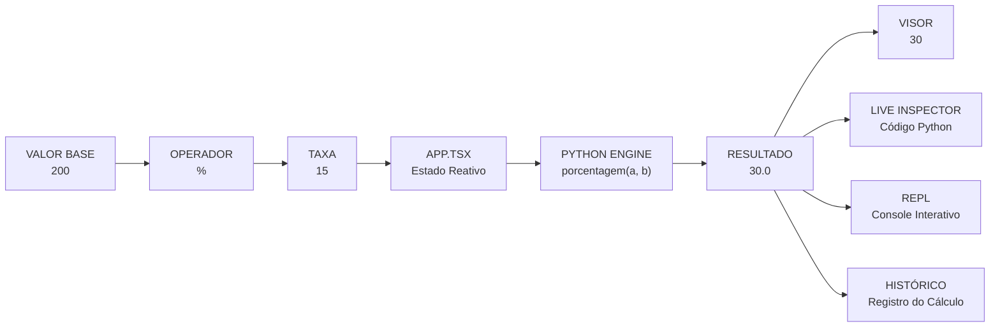

# ✦ CALCULADORA INTERATIVA — UPDATE 02
### `PERCENTAGE ENGINE // SYSTEM EXPANSION`

<p align="center">
  <strong>Y2K • CYBER TECHNOLOGY • PYTHON LAB</strong>
  <br/>
  <code>VERSION 2.0 — MATHEMATICAL EXPANSION</code>
</p>

---

## ◈ 01. OVERVIEW — VISÃO GERAL DA ATUALIZAÇÃO

A Calculadora Interativa recebeu uma expansão em seu mecanismo matemático, passando de **4 para 5 operações fundamentais**, com a implementação do cálculo de porcentagem (`%`).

A atualização amplia as capacidades matemáticas do projeto e integra a nova operação tanto ao interpretador Python quanto à interface visual interativa.

Mais do que adicionar um botão, a implementação conecta a porcentagem a todos os módulos relacionados: processamento matemático, gerenciamento de estados, teclado, visor, histórico, console interativo e sistema de explicações didáticas.

**Principais melhorias:**

- Implementação da função matemática `porcentagem(a, b)`.
- Integração da nova operação ao motor Python.
- Novo botão `%` no teclado da calculadora.
- Reconhecimento da operação pelo sistema de estados.
- Atualização do Python Live Inspector.
- Suporte ao console interativo (REPL).
- Explicação didática sobre o operador `%` em Python.
- Atualização da documentação do projeto.
- Melhorias de responsividade e apresentação visual.

### SYSTEM FLOW — FLUXO DA OPERAÇÃO



---

## ◈ 02. CORE ARCHITECTURE — ARQUIVOS ATUALIZADOS

A implementação exigiu modificações em diferentes camadas da aplicação para garantir que a nova operação fosse reconhecida e executada de maneira consistente.

| Arquivo | Camada | Atualização realizada |
|---|---|---|
| `calculadora.py` | Python Engine | Implementação da função `porcentagem()`, integração ao menu do terminal e tratamento de erros. |
| `src/types/calculator.ts` | Tipagem | Inclusão de `'percentage'` no tipo `Operation` e atualização do contrato `CalculationRecord`. |
| `src/components/CalculatorKeypad.tsx` | Interface | Adição do botão `%`, com indicação visual de operação ativa. |
| `src/components/CalculatorDisplay.tsx` | Visor | Inclusão do símbolo `%` na expressão secundária da calculadora. |
| `src/App.tsx` | Orquestração | Implementação da lógica de cálculo, gerenciamento de estado, atalho de teclado e integração com o histórico. |
| `src/utils/pythonExplanations.ts` | Motor Didático | Geração dinâmica de código Python, explicações pedagógicas e suporte ao download do arquivo `.py`. |
| `src/components/InteractiveRepl.tsx` | Console | Reconhecimento de chamadas como `porcentagem(200, 15)` e inclusão de exemplo rápido. |
| `src/components/LearningGuide.tsx` | Educação | Explicação da diferença entre o operador módulo (`%`) e o cálculo matemático de porcentagem. |
| `README.md` | Documentação | Atualização das operações disponíveis, exemplos e diagramas explicativos. |

---

## ◈ 03. MATHEMATICAL ENGINE — LÓGICA DA PORCENTAGEM

### Entendendo a operação

A porcentagem representa uma proporção de um valor em relação a 100.

Para calcular uma determinada porcentagem de um número, utilizamos:

\[
\text{Resultado} = \frac{a \times b}{100}
\]

Onde:

- `a` representa o valor-base.
- `b` representa a taxa percentual.
- O resultado representa a quantidade correspondente à porcentagem solicitada.

**Exemplo prático:**

Quanto é 15% de 200?

\[
\frac{200 \times 15}{100} = 30
\]

<pre>
  BASE VALUE       RATE       RESULT
  ┌─────────┐     ┌─────┐     ┌────────┐
  │   200   │  ×  │ 15% │  =  │   30   │
  └─────────┘     └─────┘     └────────┘
</pre>

### ATENÇÃO — Diferença entre `%` no Python e porcentagem matemática

Existe uma diferença importante entre o operador `%` da linguagem Python e o cálculo de porcentagem.

Em Python, o operador `%` representa o cálculo do **resto da divisão (módulo)**.

```python
print(10 % 3)
```

Resultado:

```text
1
```

Já para calcular uma porcentagem matemática, é necessário aplicar a fórmula correspondente.

```python
def porcentagem(a, b):
    """Retorna b% de a."""
    return (a * b) / 100
```

Exemplo:

```python
print(porcentagem(200, 15))
```

Resultado:

```text
30.0
```

Essa distinção também foi incorporada ao guia didático da aplicação, evitando que o usuário confunda dois conceitos diferentes da linguagem.

---

## ◈ 04. INTERFACE EXPANSION — EXPERIÊNCIA VISUAL

A nova operação foi integrada à interface sem comprometer a organização original da calculadora.

### 4.1. Novo botão percentual

O teclado passou a contar com o botão `%`, permitindo realizar cálculos de porcentagem diretamente pela interface.

**Comportamento visual:**

- Inclusão do símbolo `%` no teclado.
- Indicação visual quando a operação está selecionada.
- Destaque âmbar para representar o estado ativo.
- Compatibilidade com o layout responsivo existente.

Estilização aplicada ao botão:

```text
bg-amber-500
text-stone-950
ring-2
ring-amber-400
```

A tonalidade âmbar diferencia visualmente a operação enquanto ela aguarda a entrada do segundo valor.

### 4.2. Atualização do visor

O `CalculatorDisplay` recebeu o mapeamento do símbolo `%`.

A expressão secundária passa a apresentar a operação escolhida, permitindo que o usuário visualize o valor-base e o operador antes de concluir o cálculo.

Exemplo:

```text
200 %
```

Após a entrada do segundo valor e a execução da operação, o resultado é apresentado no visor.

### 4.3. Escalonamento tipográfico

O visor também considera o comprimento dos números apresentados, ajustando progressivamente o tamanho da fonte.

O objetivo é evitar que valores extensos ultrapassem os limites do componente ou provoquem quebras de linha indesejadas.

### 4.4. Atalho pelo teclado físico

A aplicação passou a reconhecer o símbolo `%` como entrada de teclado, permitindo selecionar a operação sem depender exclusivamente do clique no botão visual.

Em layouts compatíveis, o símbolo pode ser digitado utilizando `Shift + 5`.

---

## ◈ 05. RESPONSIVE SYSTEM — ADAPTAÇÃO PARA MOBILE

A implementação também contempla o comportamento responsivo do teclado e do visor.

**Ajustes realizados:**

| Elemento | Comportamento |
|---|---|
| Teclado | Grid proporcional com quatro colunas. |
| Espaçamento | Ajuste de distância entre os botões conforme a tela. |
| Altura dos botões | Dimensões adaptáveis para diferentes dispositivos. |
| Visor | Redução progressiva da tipografia para números extensos. |
| Botão `%` | Mantém seu destaque visual e sua área de interação. |

Configuração de referência do teclado:

```css
grid-cols-4
gap-2
sm:gap-2.5
h-12
sm:h-14
```

A proposta é preservar a experiência de utilização em smartphones, tablets e computadores, mantendo a organização e a acessibilidade dos controles.

---

## ◈ 06. PYTHON LIVE INSPECTOR — INTEGRAÇÃO DIDÁTICA

O inspetor de código foi atualizado para reconhecer a operação de porcentagem e apresentar sua implementação em Python.

Quando o usuário realiza um cálculo pela interface, o painel pode demonstrar a função correspondente.

**Exemplo:**

Operação realizada:

```text
200 × 15 / 100
```

Código Python apresentado:

```python
def porcentagem(a, b):
    return (a * b) / 100

resultado = porcentagem(200, 15)

print(resultado)
```

Saída:

```text
30.0
```

O painel também disponibiliza explicações sobre a fórmula utilizada, os argumentos recebidos pela função e o valor retornado.

A integração mantém a proposta pedagógica do projeto: permitir que o usuário acompanhe não apenas o resultado matemático, mas também a lógica de programação responsável por produzi-lo.

---

## ◈ 07. INTERACTIVE REPL — CONSOLE PYTHON

O console interativo recebeu suporte para reconhecer a nova função.

Agora é possível experimentar chamadas como:

```python
porcentagem(200, 15)
```

Resultado:

```text
30.0
```

Também foi adicionado um exemplo de acesso rápido para facilitar a demonstração da funcionalidade.

O console continua oferecendo suporte a expressões Python, como:

```python
2 ** 8
```

Resultado:

```text
256
```

Essa integração amplia as possibilidades de experimentação e aproxima o usuário da utilização prática da linguagem Python.

---

## ◈ 08. LEARNING GUIDE — EXPANSÃO DO CONTEÚDO DIDÁTICO

O guia de aprendizagem recebeu uma explicação específica sobre porcentagem.

O conteúdo apresenta:

- O conceito matemático de porcentagem.
- A fórmula para calcular uma taxa sobre determinado valor.
- A diferença entre porcentagem e módulo em Python.
- A utilização de funções para organizar operações matemáticas.
- Exemplos de entrada, processamento e retorno de resultados.

O objetivo é garantir que a nova funcionalidade também contribua para o aprendizado dos fundamentos da programação.

---

## ◈ 09. TERMINAL EXECUTION — COMO TESTAR

A operação está disponível tanto no script Python quanto na aplicação web.

### PYTHON MODE — Terminal

Execute o arquivo:

```powershell
cd "seu_computador/acesso_de_terminal_aqui"
python calculadora.py
```

No menu de opções:

1. Selecione a opção `5`.
2. Digite o valor-base `200`.
3. Informe a taxa percentual `15`.
4. Confira o resultado.

**Saída esperada:**

```text
Resultado: 15.0% de 200.0 = 30.0
```

### WEB MODE — Interface interativa

Para testar a funcionalidade no navegador:

1. Abra a aplicação.
2. Digite `200`.
3. Selecione o botão `%`.
4. Digite `15`.
5. Pressione `=`.
6. Confira o resultado no visor.
7. Consulte o Python Live Inspector para visualizar o código correspondente.
8. Verifique o registro da operação no histórico.

**Resultado esperado:**

```text
200 × 15 / 100 = 30
```

O inspetor deverá apresentar a chamada da função Python responsável pelo cálculo.

---

## ◈ 10. UPDATE SUMMARY — RESUMO FINAL

A implementação da porcentagem representa uma expansão do mecanismo matemático e da experiência pedagógica da Calculadora Interativa.

A aplicação passa a disponibilizar cinco operações:

| Operação | Função Python | Fórmula |
|---|---|---|
| Adição | `somar(a, b)` | \(a+b\) |
| Subtração | `subtrair(a, b)` | \(a-b\) |
| Multiplicação | `multiplicar(a, b)` | \(a\times b\) |
| Divisão | `dividir(a, b)` | \(a/b\) |
| Porcentagem | `porcentagem(a, b)` | \((a\times b)/100\) |

### STATUS DA EXPANSÃO

- [x] Nova função de porcentagem em Python.
- [x] Integração com o sistema de operações.
- [x] Novo botão percentual na interface.
- [x] Atualização do visor.
- [x] Integração com o Python Live Inspector.
- [x] Suporte ao console interativo.
- [x] Atualização do guia didático.
- [x] Suporte ao atalho de teclado.
- [x] Ajustes de responsividade.
- [x] Atualização da documentação.

---

<p align="center">
  <strong>CALCULADORA INTERATIVA</strong>
  <br/>
  <code>MATHEMATICS × TECHNOLOGY × EDUCATION</code>
  <br/><br/>
  <sub>◈ SYSTEM UPDATE 02 — PERCENTAGE ENGINE ◈</sub>
  <br/>
  <sub>Y2K DIGITAL LAB / PYTHON INTERACTIVE PROJECT</sub>
</p>
