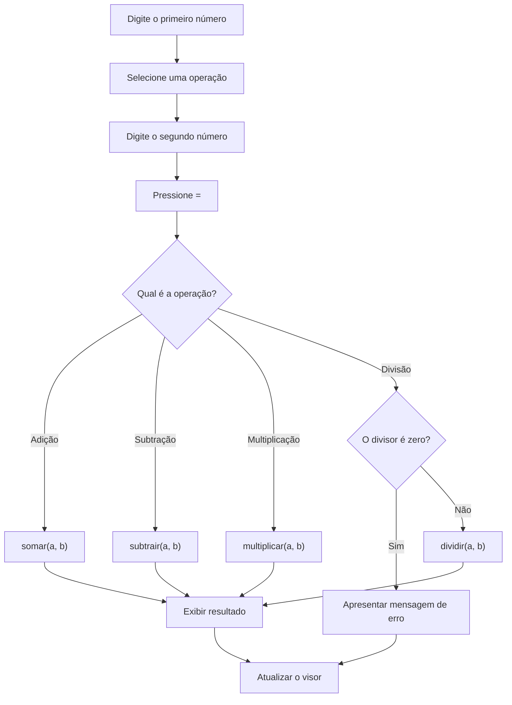

# 🧮 Calculadora Interativa com Python

Uma calculadora interativa desenvolvida para demonstrar os fundamentos da lógica de programação em Python por meio de uma interface visual. O projeto combina operações matemáticas, manipulação de dados, estruturas condicionais e tratamento de erros com ferramentas didáticas que ajudam o usuário a compreender como o código funciona.

## 📌 1. Principais componentes do projeto

O projeto está organizado em duas camadas integradas: **a lógica matemática em Python**, responsável pelas operações, e **a interface visual interativa**, que permite utilizar a calculadora e acompanhar o funcionamento do código.

### 🔢 A. Funções matemáticas fundamentais

A lógica matemática utiliza quatro funções principais:

| Função | Operação | Descrição |
|---|---|---|
| `somar(a, b)` | \(a+b\) | Soma dois valores. |
| `subtrair(a, b)` | \(a-b\) | Calcula a diferença entre dois valores. |
| `multiplicar(a, b)` | \(a\times b\) | Multiplica dois valores. |
| `dividir(a, b)` | \(a/b\) | Divide dois valores, verificando se o divisor é zero. |

Exemplo da implementação em Python:

```python
def somar(a, b):
    return a + b


def subtrair(a, b):
    return a - b


def multiplicar(a, b):
    return a * b


def dividir(a, b):
    if b == 0:
        return "Erro: Não é possível dividir por zero!"

    return a / b
```

Essas funções aplicam o princípio da **modularização**, separando cada operação em uma função específica para facilitar a leitura, a reutilização e a manutenção do código.

### 🖥️ B. Componentes da interface visual

A interface é composta por módulos que tornam o aprendizado mais visual e interativo.

| Componente | Responsabilidade |
|---|---|
| `CalculatorDisplay` | Exibe o número atual, a operação selecionada, os resultados e as mensagens de erro. |
| `CalculatorKeypad` | Reúne os números, operadores matemáticos e controles como `AC`, `C`, `⌫` e `=`. |
| `PythonLiveInspector` | Apresenta o código Python correspondente à operação realizada e explica sua lógica. |
| `InteractiveRepl` | Oferece um console simulado para testar comandos e expressões Python. |
| `LearningGuide` | Apresenta conceitos fundamentais, como funções, conversão de tipos, condicionais e tratamento de erros. |

O objetivo desses componentes é permitir que o usuário não apenas calcule resultados, mas também compreenda os conceitos de programação envolvidos.

---

## ⚙️ 2. Como a aplicação recebe os números e identifica a operação?

O processamento pode ser compreendido em três etapas principais: entrada dos dados, seleção da operação e recebimento do segundo número.

### Etapa 1 — Entrada de dados

No Python, a função `input()` recebe o valor digitado pelo usuário como uma string (`str`). Para realizar operações matemáticas, é necessário converter o texto para um tipo numérico, como `float`.

```python
numero1 = float(input("Digite o primeiro número: "))
numero2 = float(input("Digite o segundo número: "))
```

Na interface interativa, cada clique em um número aciona a função `handleNumber(digito)`. Os caracteres são concatenados para formar o número digitado.

Por exemplo:

- Primeiro clique: `1`
- Segundo clique: `5`
- Valor exibido: `15`

Esse processo permite construir números de vários dígitos antes de executar a operação.

### Etapa 2 — Identificação da operação

Quando o usuário seleciona um operador matemático, a aplicação registra o primeiro número e a operação escolhida.

Por exemplo, ao selecionar `15 ×`, o estado interno poderá armazenar:

```javascript
previousOperand = 15;
activeOperation = "multiply";
waitingForNextOperand = true;
```

Essas variáveis representam, respectivamente, o primeiro operando, a operação ativa e a indicação de que a calculadora está aguardando o próximo número.

### Etapa 3 — Recebimento do segundo número

Após escolher a operação, o usuário digita o próximo valor.

No exemplo de `15 × 4`, o visor passa a exibir `4`, enquanto a aplicação mantém registrados o primeiro número e a multiplicação selecionada.

Quando o usuário pressiona `=`, a calculadora reúne os valores e encaminha a operação para a lógica de cálculo correspondente.

---

## 🧠 3. Como a lógica de programação realiza os cálculos?

A lógica de execução é acionada quando o usuário pressiona o botão `=`.

O sistema identifica a operação ativa, executa a função matemática correspondente, trata eventuais erros e apresenta o resultado no visor.

### Fluxo de execução



### A. Estruturas condicionais

As estruturas `if`, `elif` e `else` permitem que o programa escolha qual função executar com base na operação selecionada.

```python
if operacao == "add":
    resultado = somar(numero1, numero2)

elif operacao == "subtract":
    resultado = subtrair(numero1, numero2)

elif operacao == "multiply":
    resultado = multiplicar(numero1, numero2)

elif operacao == "divide":
    resultado = dividir(numero1, numero2)
```

Esse mecanismo representa uma tomada de decisão: o programa avalia a condição correspondente e executa o bloco apropriado.

### B. Tratamento de erros: divisão por zero

A divisão por zero é uma situação que precisa ser verificada antes de realizar o cálculo.

```python
def dividir(a, b):
    if b == 0:
        return "Erro: Não é possível dividir por zero!"

    return a / b
```

A condição `if b == 0` impede que a divisão seja executada quando o divisor é zero. Nesse exemplo, a função retorna uma mensagem informativa em vez de realizar a operação.

Esse mecanismo demonstra a importância da **validação de dados e do tratamento de situações excepcionais** na programação.

### C. Apresentação do resultado

Após o cálculo, a interface atualiza o visor com o resultado obtido.

O processo pode incluir:

- **Formatação numérica:** controlar a quantidade de casas decimais exibidas.
- **Atualização do visor:** substituir a expressão anterior pelo resultado.
- **Histórico de cálculos:** registrar operações, quando esse recurso estiver habilitado.
- **Inspetor de Python:** apresentar a função e a lógica relacionadas à operação realizada.

A formatação serve para melhorar a legibilidade, mas deve ser feita de maneira que não introduza alterações indevidas na precisão dos cálculos.

---

## 🐍 4. Inspetor de código e console interativo

Além das operações matemáticas, o projeto oferece recursos didáticos voltados ao aprendizado da linguagem Python.

### Python Live Inspector

O inspetor apresenta uma representação do código Python correspondente à operação realizada na interface.

Por exemplo, para a multiplicação de `15` por `4`, o código demonstrativo poderá ser:

```python
numero1 = 15
numero2 = 4

resultado = multiplicar(numero1, numero2)

print(resultado)
```

Saída esperada:

```text
60
```

Dessa forma, o usuário consegue relacionar a ação executada na calculadora com as instruções utilizadas para realizar a operação.

### Interactive REPL

O console simulado permite experimentar comandos e expressões, como:

```python
somar(10, 5)
```

Resultado:

```text
15
```

Também é possível demonstrar expressões matemáticas da linguagem Python:

```python
2 ** 8
```

Resultado:

```text
256
```

O operador `**` representa a exponenciação em Python.

O console é uma ferramenta de aprendizagem que permite observar o comportamento de expressões e funções. Sua capacidade de execução depende de como foi implementado na aplicação.

---

## 📚 5. Conceitos de programação abordados

O projeto permite explorar diferentes fundamentos da programação:

| Conceito | Aplicação no projeto |
|---|---|
| Funções | Separação das quatro operações matemáticas. |
| Parâmetros e argumentos | Recebimento dos valores utilizados nos cálculos. |
| Retorno de valores | Entrega do resultado por meio de `return`. |
| Tipos de dados | Utilização de strings e números, incluindo `float`. |
| Conversão de tipos | Transformação da entrada textual em valor numérico. |
| Estruturas condicionais | Seleção da operação e validação do divisor. |
| Tratamento de erros | Prevenção e comunicação de situações inválidas. |
| Manipulação de estado | Armazenamento dos números e da operação na interface. |
| Modularização | Separação entre lógica matemática e componentes visuais. |
| Saída de dados | Apresentação dos resultados no visor e no console. |

---

## ✅ 6. Conclusão

A calculadora combina operações matemáticas básicas com recursos visuais que facilitam a compreensão da lógica de programação.

Sua principal proposta é transformar uma atividade cotidiana, como realizar cálculos, em uma oportunidade para aprender como funções, variáveis, estruturas condicionais e tratamento de erros trabalham em conjunto.

Com o visor interativo, o teclado, o inspetor de código e o console didático, o projeto busca aproximar a prática da programação de uma experiência visual e acessível.

**Mais do que uma calculadora, o projeto é uma ferramenta didática para explorar os fundamentos de Python por meio da interação.**
